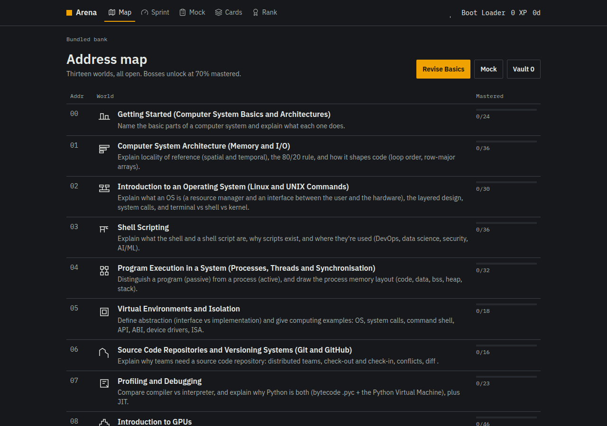
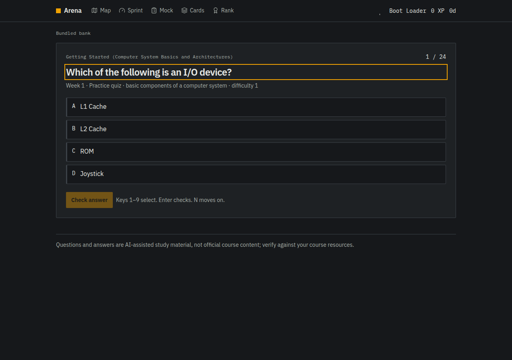
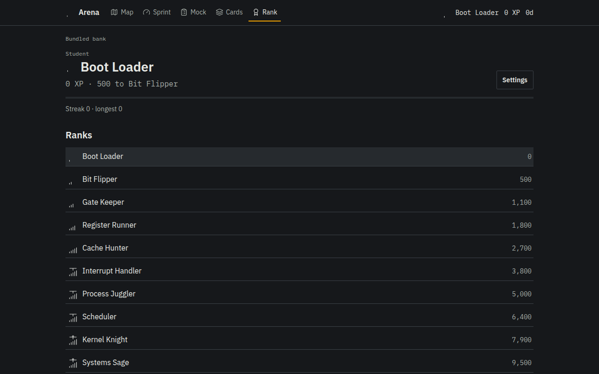
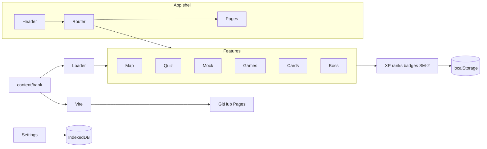

# Computing Systems Arena


[](https://github.com/PrafullJ0shi/computing-systems-arena/actions/workflows/pages.yml)
[](https://github.com/PrafullJ0shi/computing-systems-arena/actions/workflows/ci.yml)
[](LICENSE)

**Live:** https://prafullj0shi.github.io/computing-systems-arena/

A revision bench for the Computing Systems course. Thirteen worlds, quizzes, a short game in each world, bosses, flashcards, and a 40-question mock. Progress stays in the browser.

Questions and answers are AI-assisted study material, not official course content; verify against your course resources.

## Screens









## Features

- Address map of 13 worlds, all unlocked
- Practice-quiz and multi-select items, explanation and trap after each answer
- Unverified items stay in the deck, with a report link
- XP and ten ranks, Boot Loader through Systems Sage (9,500 XP)
- Streak, mistake vault, revision sprint ordered by weak topics
- Timed mock, results by week, review
- Boss prompts with a shared 5-step rubric, unlocked at 70% mastery
- Flashcards on SM-2
- One drill game per world, and a badge when you clear it
- Export, import, and reset progress. Optional bank import in the browser

## Architecture

The shell draws the header and the route. The hash router mounts one feature page. Pages read a bank assembled at build time and a progress record in localStorage. Scoring, XP, ranks, badges, and card spacing live in pure functions. An imported bank, if any, sits in IndexedDB and overrides weeks it contains. Vite inlines the JSON. GitHub Actions builds `dist` and Pages hosts it.




Detail, including the folder tree: [docs/ARCHITECTURE.md](docs/ARCHITECTURE.md). The visual rules are in [docs/DESIGN.md](docs/DESIGN.md).

## Quick start

```bash
npm install
npm run dev
```

Open http://localhost:5173/computing-systems-arena/

```bash
npm test
npm run lint
npm run build
```

## Project structure

```
content/bank/     default questions, mock, bosses, cards
content/sample/   small fallback used by tests
src/pages/        routes
src/games/        week drills
src/lib/          loader, scoring, XP, SM-2
src/components/   shell, quiz, marks
public/           manifest, icons, robots, sitemap
```

An optional overlay can live in gitignored `content/private/` or in `VITE_PRIVATE_CONTENT_DIR`. Settings can also import JSON or a zip into IndexedDB.

## Roadmap

- v1: map, quiz, mock, ranks, bosses, cards, drills, Pages
- Next: deeper simulators inside the week games, and a printable week summary

## Contributing

Open an issue before a large change. Run `npm test` and `npm run lint`. Do not add secrets. Question files follow `content/bank/schema/question.schema.json`. See [SECURITY.md](SECURITY.md) and [CODE_OF_CONDUCT.md](CODE_OF_CONDUCT.md).

## Stack

React, Vite, TypeScript, Tailwind, IBM Plex, Lucide. MIT licensed.
