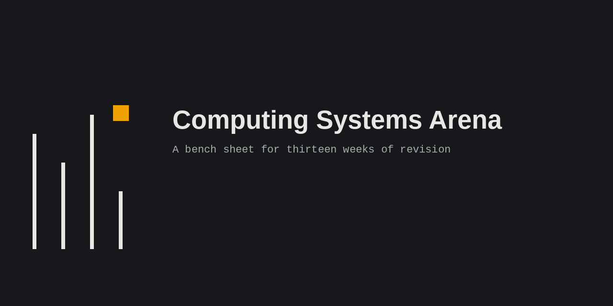
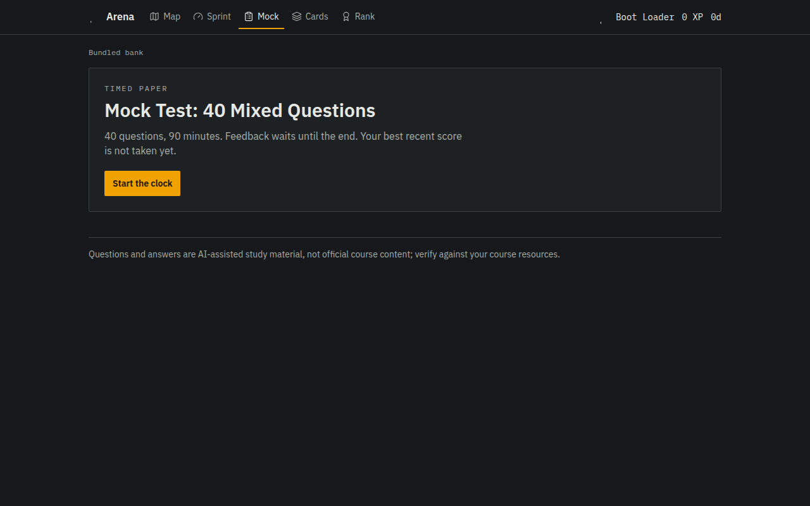
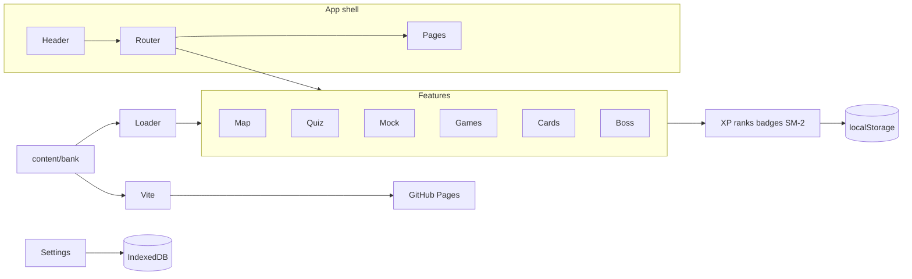
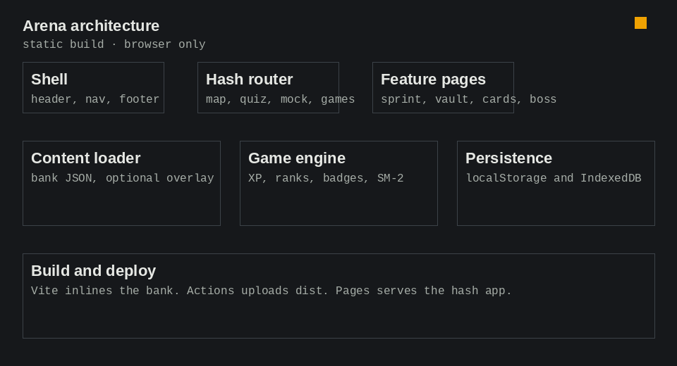

# Computing Systems Arena



[](https://github.com/PrafullJ0shi/computing-systems-arena/actions/workflows/pages.yml)
[](https://github.com/PrafullJ0shi/computing-systems-arena/actions/workflows/ci.yml)
[](LICENSE)

**Live:** https://prafullj0shi.github.io/computing-systems-arena/

A revision bench for the Computing Systems course. Thirteen worlds, quizzes, a short game in each world, bosses, flashcards, and a 40-question mock. Progress stays in the browser.

Questions and answers are AI-assisted study material, not official course content; verify against your course resources.

## Screens





## Features

- Address map of 13 worlds, all unlocked
- Practice-quiz and multi-select items, explanation and trap after each answer
- Unverified items stay in the deck, with a report link
- XP and ten ranks, Boot Loader through Systems Sage (9,500 XP)
- Streak, mistake vault, revision sprint ordered by weak topics
- Timed mock, results by week, review
- Boss prompts with a shared 5-step rubric, unlocked at 70% mastery
- Flashcards on SM-2
- One drill game per world, and a badge when you clear it
- Export, import, and reset progress. Optional bank import in the browser

## Architecture

The shell draws the header and the route. The hash router mounts one feature page. Pages read a bank assembled at build time and a progress record in localStorage. Scoring, XP, ranks, badges, and card spacing live in pure functions. An imported bank, if any, sits in IndexedDB and overrides weeks it contains. Vite inlines the JSON. GitHub Actions builds `dist` and Pages hosts it.





Detail, including the folder tree: [docs/ARCHITECTURE.md](docs/ARCHITECTURE.md). The visual rules are in [docs/DESIGN.md](docs/DESIGN.md).

## Quick start

```bash
npm install
npm run dev
```

Open http://localhost:5173/computing-systems-arena/

```bash
npm test
npm run lint
npm run build
```

## Project structure

```
content/bank/     default questions, mock, bosses, cards
content/sample/   small fallback used by tests
src/pages/        routes
src/games/        week drills
src/lib/          loader, scoring, XP, SM-2
src/components/   shell, quiz, marks
public/           manifest, icons, robots, sitemap
```

An optional overlay can live in gitignored `content/private/` or in `VITE_PRIVATE_CONTENT_DIR`. Settings can also import JSON or a zip into IndexedDB.

## Roadmap

- v1: map, quiz, mock, ranks, bosses, cards, drills, Pages
- Next: deeper simulators inside the week games, and a printable week summary

## V2 roadmap

Planned for V2, not shipped. V1 is one course. V2 turns the engine into a revision bench for any course while keeping progress private by default. Course material from a provider is never sold; only original content can be paid.

1. **Course packs.** A pack format (manifest plus the existing question schema) so any course loads the same map, quizzes, mock, bosses and cards; Computing Systems becomes the first pack. *Learners:* one app for every subject. *Developers and teachers:* write content, not code.
2. **Pack studio.** A browser editor that checks items against the schema as you type and previews them in the real quiz screen. *Authors:* build a pack without touching JSON by hand.
3. **FSRS scheduling.** Replace SM-2 with the open FSRS algorithm (the `ts-fsrs` library), with a desired-retention setting. *Learners:* reviews timed to their own memory rather than a fixed curve.
4. **Anki, Moodle and QTI interchange.** Import and export decks and question sets in Anki, Moodle GIFT and QTI formats. *Learners:* bring existing decks. *Teachers:* reuse items in the learning system they already run.
5. **Peer duel.** Two learners answer the same timed set over a direct WebRTC connection, with no accounts and no server storing answers. *Learners:* revision that feels like a match.
6. **Rubric feedback on written answers.** For boss prompts, an offline check of a written answer against the five-step rubric, listing which steps are missing; no answer leaves the browser. *Learners:* feedback on long answers, not only multiple choice.
7. **Exam countdown planner.** Enter the exam date and get a daily plan built from weak topics and the reviews already due. *Learners:* a realistic plan instead of last-night cramming.
8. **Teacher class view.** A class code that lets students opt in to share only aggregate scores, so a teacher sees which topics the class is weak on. *Teachers:* target the next lesson. *Revenue:* students stay free; a hosted teacher plan is paid.
9. **Accessibility and offline install.** Full keyboard use, screen-reader labels, reduced-motion mode and an installable offline app. *Learners:* revise anywhere, in any setup.
10. **Pack marketplace for original content.** Authors publish packs they wrote themselves, free or paid, with a licence check before listing. *Developers and authors:* income from good material. *Revenue:* a share of paid pack sales.

**Order.** V2.0: items 1, 3, 4, 7 and 9. V2.1: items 2, 5, 6, 8 and 10.

## Contributing

Open an issue before a large change. Run `npm test` and `npm run lint`. Do not add secrets. Question files follow `content/bank/schema/question.schema.json`. See [SECURITY.md](SECURITY.md) and [CODE_OF_CONDUCT.md](CODE_OF_CONDUCT.md).

## Stack

React, Vite, TypeScript, Tailwind, IBM Plex, Lucide. MIT licensed.
