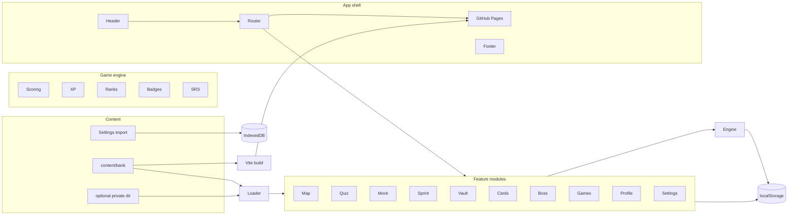

# Architecture

The app is a static React site. There is no account and no server. The question bank is compiled into the bundle. Progress stays on the device.



## Folder structure

```
content/bank/          bundled weeks, mock, bosses, flashcards, schema
content/sample/        small fixture bank used by tests and as a fallback
content/private/       optional gitignored overlay
src/components/        shell, quiz runner, schematic marks
src/config/            worlds, ranks, copy
src/context/           progress and bank state
src/games/             one drill per world
src/lib/               loader, scoring, XP, SM-2, import, engines
src/pages/             routes
public/                favicon, manifest, robots, sitemap, social image
.github/workflows/     CI and Pages
```

## Content loader

`vite/bankPlugin.ts` reads `content/bank/data` at build time. If that folder is empty it uses `content/sample`. `VITE_PRIVATE_CONTENT_DIR` or `content/private` overlays those files. The loader accepts missing fields, option objects `{id, text}`, and `correctAnswers`. Source values are `quiz`, `extra`, and `mock`. Ids look like `W02-Q014`.

## Game engine

A correct first answer pays XP from difficulty. Ranks run from Boot Loader at 0 XP to Systems Sage at 9,500. Clearing a world game grants its badge. Flashcards use SM-2. Bosses unlock when 70% of that world's questions have been answered correctly at least once.

## Persistence

`csa.progress.v1` in localStorage holds XP, answers, mistakes, badges, card schedules, and mock history. An imported bank is stored in IndexedDB under `csa` / `imported-bank` and merged over the bundle.

## Deploy

`npm run build` typechecks and runs Vite with base `/computing-systems-arena/`. Pushing `main` runs the Pages workflow, which uploads `dist`. The router is a hash router, so a refresh on a deep link still loads `index.html`.
